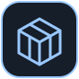
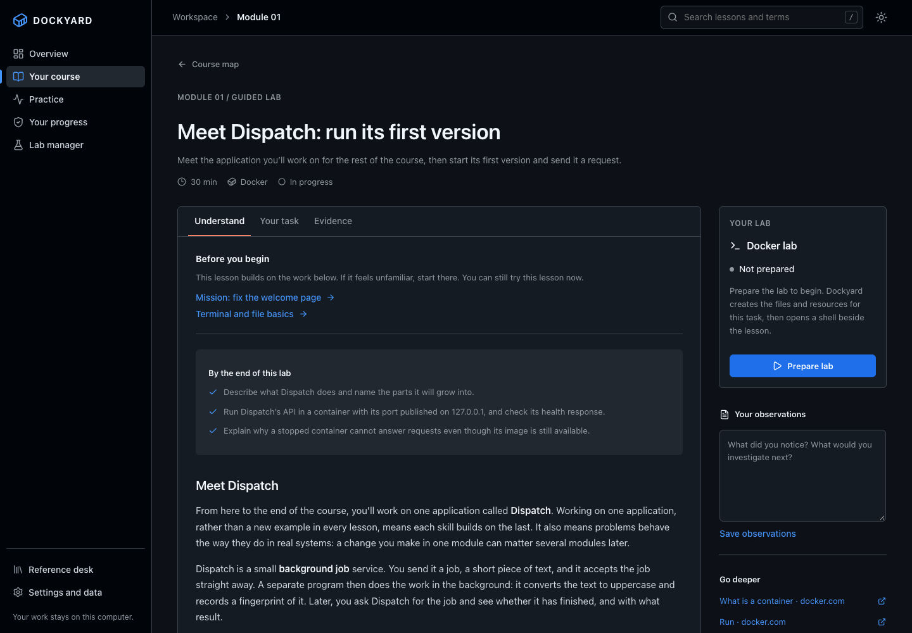

<p align="center">
  
</p>
<h1 align="center">Dockyard</h1>
<p align="center"><strong>Learn Docker and Kubernetes by operating a real system.</strong></p>
<p align="center">A personal learning workbench for macOS, Linux, and Windows through WSL 2, with browser lessons beside a real terminal and an evolving Dispatch application.</p>
<p align="center"><a href="#start-learning">Start learning</a> · <a href="docs/user-guide.md">User guide</a> · <a href="docs/curriculum.md">Curriculum</a> · <a href="docs/runtime-evidence.md">Runtime evidence</a></p>

## Start learning

This checkout includes a local launcher after installation.
A local Docker Engine provides the practical lab environment, and each lab's shell runs on this computer.
See [platform setup](docs/platforms.md) for macOS, Linux, and Windows/WSL prerequisites.
The source installer also needs Node/npm and uv; it downloads application dependencies, builds the browser assets, and installs into this repository's private environment.
It does not alter shell configuration or Docker Desktop settings.

```sh
./scripts/install.sh
./dockyard doctor
./dockyard
```

The browser opens a local workbench with a one-time sign-in.
Choose **Your course → Find your starting point** if you already work with containers, or **Start learning** for the complete sequence.
Prepare a lab, and its terminal opens beside the lesson; then check the behavior you created.
Prefer your own terminal, an editor terminal, or tmux?
The terminal menu opens the same lab shell there; see [terminal compatibility](docs/terminals.md) for details.
Tools, container images, and native VM packages download as required; Lab Manager can prefetch a module or track.

[](docs/assets/workbench.png)

## The learning loop

Read a short explanation, make a prediction, operate the real environment, and inspect the evidence.
Checks examine files, resource identity, and running behavior rather than command history.
Hints and reference solutions stay separate from independent demonstrations.

The course contains 129 teaching labs and missions across 31 modules, 12 incident scenarios, and six original timed practice exams oriented to the CKA, CKAD, and CKS.
It begins with illustrated container foundations.
Then it introduces Dispatch, which grows from one process into a distributed application.
Along the way you learn Compose, Kubernetes, delivery automation, security, native kubeadm administration, and cluster and workload hardening.
The [objective map](docs/sources/objective-map.md) connects the published objectives to explanations, practice, and assessment.

Successful missions create immutable source checkpoints.
Carry selected files into later missions, keep a portfolio of infrastructure and operational evidence, and revisit skills through spaced review.
Progress archives move notes and historical evidence between profiles while preserving current workspaces.

No AI service, account, telemetry, cloud credentials, or paid infrastructure is required.
Local labs and original practice exams do not reproduce production failure domains or certification proctoring.

## Working locally

The browser and CLI share one assessment service.
The ordinary external shell has your user privileges; resource ownership checks are not an operating-system sandbox.
Dockyard scopes cleanup to recorded, verified resources and keeps native VM labs and application clusters mutually exclusive.

Lessons and saved progress work offline.
Lab Manager reports pinned cache availability and identifies remaining network-dependent build or bootstrap steps.
See [operation and recovery](docs/user-guide.md#operate-your-labs) before resetting or cleaning a lab.

## Development

```text
dockyard/
├── frontend/                 React workbench and installed-browser journeys
├── src/dockyard/
│   ├── content/              Canonical lessons, checkpoints, objectives, and pins
│   ├── probes/               Observations used by behavior checks
│   ├── runtimes/             Owned Docker, kind, and Lima lifecycle adapters
│   ├── service.py            Shared browser and CLI operations
│   └── web.py                Authenticated loopback API
├── tests/                    Contracts and real-runtime integration gates
├── scripts/                  Installation, the fast check script, and contract generation
├── docs/                     Learning, operation, and verification guides
└── pyproject.toml            Python package and development configuration
```

Run `./scripts/check.sh` for every fast check, including lint, types, tests, the structural audit, and dependency advisories.
Use the [maintenance guide](docs/maintenance.md) for source setup, generated contracts, real-runtime suites, and release checks.
The [platform validation](docs/platform-validation.md) records cross-platform checks and remaining verification limits.
The [original release validation](docs/release-validation.md) preserves the macOS baseline.
The [runtime evidence log](docs/runtime-evidence.md) records the underlying staged observations.

For help, include the activity ID, the action you took, the diagnostic shown, and the output of `./dockyard doctor`, which includes the app version.
Exclude kubeconfigs, credentials, private keys, and raw lab databases.

## License

Dockyard is available under the [MIT License](LICENSE).
The bundled JetBrains Mono Nerd Font uses the [SIL Open Font License](frontend/src/fonts/OFL.txt).
The CSI teaching manifests keep their [Apache 2.0 license](src/dockyard/content/runtime/csi/LICENSE).
